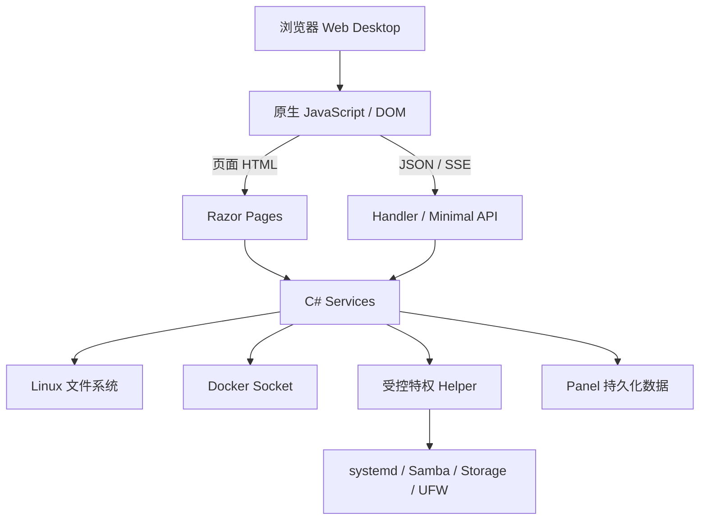
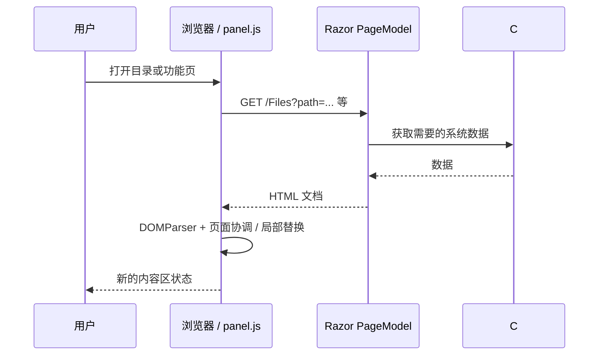
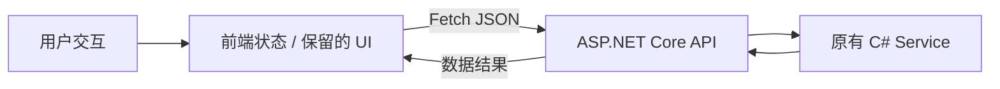

# YRMPanel — 项目交接与现阶段工作记录

> **文档用途：** 为开发者、维护者及后续 AI 提供可核对的当前状态；记录需求、技术边界、现存风险和下一步工作。  
> **本次整理日期：** 2026-11-22（MYT）。  
> **审查基准：** [`yuanruoming/yrm-panel`](https://github.com/yuanruoming/yrm-panel)，`master` Commit [`1bfdd133c57ecebca7ca4b10f6ca7045a8894e74`](https://github.com/yuanruoming/yrm-panel/commit/1bfdd133c57ecebca7ca4b10f6ca7045a8894e74)（2026-11-22 09:33 UTC）。  
> **源码版本：** `1.0.0-beta.12.2`，以 [`YrmPanel/YrmPanel.csproj`](YrmPanel/YrmPanel.csproj) 为准。  
> **证据边界：** 本档案核对了上述源码、脚本和工作流定义。没有登录实际 Ubuntu 设备，也没有在本次文档整理中重新运行 .NET Build、真实浏览器 E2E、安装生命周期或性能基准。**代码存在、工作流存在、测试执行成功、真实设备验收成功是四种不同的事实。**

## 1. 使用与维护规则

### 1.1 状态术语

| 状态 | 含义 |
|---|---|
| `Implemented` | 在当前源码中能定位实现；不等于功能已验收 |
| `Verified` | 有明确的测试方法、运行结果与提交/环境关联的证据 |
| `Known Issue` | 有问题报告、复现记录或可识别的代码风险 |
| `Not Verified` | 尚未取得所要求环境下的可靠验收结果 |
| `Planned` | 讨论过或计划中，但不能视作已实施 |

本文将**用户已确认的产品要求**与**当前源码可证实的实现**分开记录。性能判断应有请求耗时、浏览器指标和主机数据支持；技术建议不能代替验证结果。

### 1.2 文档维护约定

- 只维护两份根目录项目 Markdown：`README.md`（公开说明）与 `PROJECT_HANDOFF.md`（交接/现状）。
- 每次重要更新同步修订本文件顶部的源码基准、相关模块状态、风险与验收记录；README 只在对外功能或部署方式变化时更新。
- 不新建独立的 `BETA*_HANDOFF.md`、临时项目总结或重复 Changelog。细节留在 Git Commit / PR / Release 记录中；本文件保留足以理解架构演进的摘要。
- 不以个人评价描述工程质量。记录**现象、代码证据、影响、处理状态、验证边界**。
- 第三方组件中的 `LICENSE.md` 等法律/许可文件不属于本次精简对象，必须保留。

## 2. 产品定位与范围

**YRMPanel 是个人使用的 Ubuntu / Debian Server Web Desktop 与轻量 NAS 管理面板。** 产品目标是把 Linux 已有服务统一到一个桌面式浏览器界面中，而不是重新实现操作系统、文件系统、Samba、Docker Engine 或防火墙。

### 2.1 既定目标

- 单人管理，复用现有 Linux 用户与真实文件权限；不以多租户或企业 RBAC 为近期核心。
- 桌面式 UI：壁纸、顶部状态、Taskbar、窗口与应用内容连续存在。整体视觉保持已确定的深色、扁平、简洁风格。
- 优先完成 Files、SMB、Storage、Docker、Monitor、Settings 的日常管理；避免无必要地重复设置入口或扩展应用商店。
- 以底层系统为数据源：文件对应真实目录，SMB 对应原生 Samba，容器对应 Docker Engine。
- 高优先级的非功能要求：**稳定、低交互延迟、状态保留、更新可恢复、日常维护成本低**。
- 不因更换框架重画已确认的视觉设计；性能目标与 Vue/React 的采用与否是两个独立问题。

### 2.2 非当前承诺

- 自研 OS、Docker Engine、SMB 协议栈、NAS 文件系统。
- 面向公众的完整应用商店或完整 Docker Compose/Stack YAML 管理套件。
- 全自动证书 ACME/Let's Encrypt 生命周期、媒体转码、企业多用户管理。
- 当前源码不能被描述成已完成的完整 SPA。

## 3. 源码与运行架构

| 层 | 技术/入口 | 职责 |
|---|---|---|
| 操作系统 | Ubuntu/Debian、Linux 用户、systemd | 身份、权限、磁盘、服务 |
| Web 后端 | ASP.NET Core 10、Razor Pages | HTTP、认证、页面/接口、请求校验 |
| 前端 | 原生 JavaScript、CSS、Razor HTML | 桌面、窗口、导航、局部 DOM 与交互 |
| 异步接口 | Razor Handler、Minimal API、Fetch、SSE | 局部 JSON、监控及更新状态 |
| 文件系统 | `FileManagerService` | 文件浏览与操作，遵守底层文件权限 |
| Docker | `DockerApiService`、Unix Socket | Docker Engine API |
| Samba / Storage / Firewall | C# Service、固定 root-owned Helper | 受控的系统管理操作 |
| 设置/历史 | `PanelSettingsStore`、Panel 数据目录 | 持久化 JSON、证书、壁纸和历史 |
| 构建发布 | GitHub Actions、`dotnet publish`、Shell 脚本 | 生成资产、校验、安装与恢复 |



### 3.1 关键代码入口

| 职责 | 文件 |
|---|---|
| DI、认证、中间件、API | `YrmPanel/Program.cs` |
| 桌面布局 | `YrmPanel/Pages/Shared/_Layout.cshtml` |
| 桌面与页面路由 | `YrmPanel/wwwroot/js/panel.js` |
| 文件视图 / PageModel | `YrmPanel/Pages/Files.cshtml`、`Files.cshtml.cs` |
| 文件系统服务 | `YrmPanel/Services/FileManagerService.cs` |
| 文件树展开与文件夹导航 | `YrmPanel/wwwroot/js/v1-tree-navigation.js` |
| 文件选择、文件操作与预览 | `YrmPanel/wwwroot/js/v1-stability.js`、`v1-files.js` |
| Files 状态快照 | `YrmPanel/Services/FilesNavigationSnapshot.cs` |
| Settings 与持久化 | `YrmPanel/Pages/Settings.cshtml(.cs)`、`Services/PanelSettingsStore.cs` |
| Docker / Samba / Storage | `Services/DockerApiService.cs`、`SambaManagementService.cs`、`StorageDeviceService.cs` |
| DDNS / Firewall / TLS | `Services/DdnsService.cs`、`FirewallService.cs`、`PanelCertificateService.cs` |
| 监控发布与渲染 | `Services/MetricsPublisher.cs`、`wwwroot/js/rc4-monitor.js` |
| 安装、更新、卸载 | `scripts/install.sh`、`scripts/update.sh`、`scripts/uninstall.sh` |
| 发布校验 | `scripts/release-manifest.sh`、`scripts/verify-release.sh` |
| 系统服务配置 | `packaging/yrm-panel.service` |

## 4. 当前请求与 UI 更新逻辑

### 4.1 现有 HTML 导航



`panel.js` 中仍有 `fetchWorkspacePage()`、`DOMParser`、`reconcileWorkspaceView()` 及 Files/Settings 的 DOM 协调。浏览器不一定发生顶层网页刷新，但数据导航**仍可能生成/下载 HTML 并重建部分 DOM**。

### 4.2 已有的异步数据能力

- `/Files?handler=Tree&path=...`：获取子目录 JSON，用于展开目录树。
- `/api/metrics`、`/api/metrics/stream`：指标读取与 SSE；`rc4-monitor.js` 订阅共享指标通道，减少重复读取。
- `/api/update/status`、Settings 的若干 Handler：更新与交互数据。
- Files 已采用页面预取、短期缓存与保留部分 DOM 的实现，**但主目录导航目前仍以 HTML 页面为载体**。

### 4.3 后续可能的简化方向（`Planned`，并非已实施）

高频目录/状态操作可使用专用 JSON API：按需调用既有 C# Service，返回必要数据；浏览器保留窗口、侧边栏与选择状态，只更新受影响的组件。



该方向能减少不必要的 Razor HTML 生成、HTML 解析和节点替换，但**不会消除真实磁盘读取、系统命令、网络延迟或必需的 UI 更新**。是否引入 Vue / React 需要独立论证；当前代码没有实施全面 SPA 迁移。

## 5. 功能状态台账（以源码为依据）

| 模块 | 当前实现范围 | 验证状态/边界 |
|---|---|---|
| Linux 登录 / HTTPS | PAM、Cookie Session、自签名证书、手动证书导入/恢复 | `Implemented`；真实安装/登录场景需对应 E2E 证据 |
| Desktop | 壁纸、Taskbar、窗口、顶部状态 | `Implemented`；跨模块交互回归不可仅靠源码断言 |
| Overview / Monitor | Linux 指标、共享 SSE 通道、UI 订阅 | `Implemented`；长期运行与重连体验需实测 |
| Files | Root、Home、My Files、挂载卷、Quick Access、目录树 | `Implemented`；导航速度与点击一致性仍需真实基准 |
| Files 操作 | 选择/多选、上传、下载/ZIP、创建、复制、移动、重命名、删除 | `Implemented`；大目录、权限、中断和长文件名情境需验收 |
| Files 预览 | 图片、文本、PDF、视频等浏览器原生预览 | `Implemented`；路径与 HTTP Range (206) 回归重要 |
| SMB | 原生共享创建/查看/停止共享、只读选项 | `Implemented`；Windows SMB 客户端读写必须另测 |
| Storage | 磁盘/分区、挂载/卸载、受控初始化/恢复 | `Implemented`；破坏性操作只能在废弃测试盘上验证 |
| Docker | 容器状态、日志、部分控制 | `Implemented`；控制默认可能关闭，不等于完整 Compose 管理 |
| Network / DDNS | 网络信息及 Dynu / Cloudflare / 自定义 HTTPS DDNS | `Implemented`；具体服务商行为需外部实测 |
| Firewall | UFW 与受限 Docker IPv4 iptables 规则、确认/恢复 | `Implemented`；不是通用 IPv6/nftables 防火墙 |
| Appearance | 当前壁纸、历史、头像等 | `Implemented`；浏览器缓存与视觉闪烁需实测 |
| Updates | Dev/Stable、校验、失败回滚机制 | `Implemented`；运行结果与特定服务器更新状态需分别确认 |
| Applications / Services / Shares 旧入口 | 可能作为路由兼容或重定向保留 | 非独立已成熟应用商店或多中心系统 |

**配置细节：** `YrmPanel/appsettings.json` 中 `Docker:EnableControls` 默认是 `false`；具体部署可能通过环境变量覆盖，不能只凭源码判断设备运行时的开关状态。

## 6. Files：实际执行路径与近期优化

### 6.1 当前 `Files.OnGetAsync()`

主要路径见 `YrmPanel/Pages/Files.cshtml.cs`：

1. 获取 Quick Access Pin。
2. 调用 `FilesNavigationSnapshot.GetAsync()` 获取挂载设备及 Samba 只读快照。
3. 整理 PhysicalDisks 与 MountedVolumes，并调用 `DiscoverMyFiles()`。
4. 对实际目录调用 `FileManagerService.Browse()`，整理权限、展示项及分享信息。
5. Razor 生成 HTML，前端导航通过解析与协调 DOM 显示内容。

**已改进但尚未拆除的依赖：** 普通目录浏览仍经过设备/Samba 快照与 My Files 发现。即便快照命中缓存，仍存在这些调用与页面渲染路径；不能把“有缓存”写成“目录浏览已完全按需独立”。

### 6.2 最新源码中的具体优化

- `FileManagerService.ListChildDirectoryNames()` 直接枚举子目录，`DiscoverMyFiles()` 不再为了寻找文件夹读取完整文件列表。
- `FilesNavigationSnapshot`：新鲜数据有效期约 3 秒；过期但处于允许窗口（约 5 分钟）内，先返回已有只读数据并尝试后台刷新；显式 Refresh 与由 Panel 发起的挂载/共享操作有失效路径。
- `panel.js`：Files 页面预取、短期缓存、保留部分窗口与导航 DOM；仍存在请求 HTML 的流程。
- `v1-tree-navigation.js`：箭头展开、子目录 JSON 获取及有限缓存，文件夹双击导航。
- Files PageModel 已包含 `Server-Timing` 分段信息，可用于定位请求耗时，但**未取得目标主机的实际测量结果**。

### 6.3 已确定的交互规则

| 区域 | 单击 | 双击 | 说明 |
|---|---|---|---|
| 普通文件夹行/名称 | 选中 | 进入文件夹 | 不能拦截其他模块的单击 |
| 文件夹箭头 | 展开/收起 | 不作为导航入口 | 文件夹图标保持静止 |
| 普通文件 | 选中 | 打开/预览（受类型影响） | 保留多选与操作菜单 |
| My Files 顶部特殊入口 | 展开/收起 | 打开 My Files | 一个静态文件夹图标，不同于目录行 |
| Settings / Files 普通导航链接 | 正常导航 | 不要求双击 | 不应被文件夹事件处理器拦截 |

当前通过 `data-fm-href`、`yrm-panel:navigate` 自定义导航的实现，必须与桌面导航和可访问性行为一起验证。文件名应保持图标同一行并截断显示；上传、下载、预览、SMB Shared 状态和 More 菜单不能因为导航优化而回退。

### 6.4 已知问题/历史回退

| 编号 | 现象或风险 | 当前证据状态 |
|---|---|---|
| F-01 | 目录点击时有页面加载感 | `Known Issue`：HTML 页面请求仍存在；实际耗时未测定 |
| F-02 | 修改单击/双击后曾波及其他单击导航 | 历史问题；源码已有针对性修正，最新实机是否完全恢复仍 `Not Verified` |
| F-03 | 媒体预览曾因当前路径与 URL 不一致失败 | 历史回退；嵌套目录和 HTTP Range 需要持续回归 |
| F-04 | 安装/诊断残留文件曾出现在 Home | 源码含对已知名称的展示过滤；真实文件身份、过滤效果与删除均未实机确认 |
| F-05 | Recently Used 壁纸缩略图曾重新加载/闪烁 | 最近源码修改缩略图复用与请求行为；实际视觉结果需实测 |
| F-06 | 文件名过长、选择、菜单、侧边栏滚动不一致 | 已有多轮修复；需以真实浏览器/窗口尺寸复核 |

以上是代码风险与反馈记录，不应在缺少复现时宣称每项在当前 Commit 必然存在，也不应把某项修复代码存在等同于已经解决。

## 7. 其他模块重要实现与限制

### 7.1 Settings / Wallpaper

- Settings 分区包含 Overview、Storage、Network、Dynamic DNS、Firewall、Certificates、Appearance、About & Updates。
- 壁纸与历史保存在 Panel 数据目录，历史图片最多约 10 张，并按内容去重；不使用一个独立的图片数据库。
- 当前桌面壁纸使用 `/wallpaper?v=...` 版本化 URL；历史图片 Endpoint 配置私有长期缓存。近期加入缩略图节点复用以减少再次进入 Appearance 时的闪烁。
- 历史图片并非已证实存在独立生成的低分辨率缩略图文件；不应把浏览器缓存优化当作图片生成管线。

### 7.2 Storage / Samba

- 存储发现依赖 `lsblk` 和系统磁盘信息；特权操作通过受限制的 Helper 执行。
- Samba 管理目标是使用系统原生配置，尽量不改变非 YRM 管理的共享；停止共享不删除真实文件。
- 挂载、初始化、磁盘恢复与 UFW 远程激活属于高风险操作。只允许在可恢复的隔离 VM 或废弃测试盘上验证破坏性路径。

### 7.3 Docker / Network / DDNS / Firewall / Certificates

- Docker Engine 由系统提供，Panel 通过 Unix Socket 读取；容器操作许可受配置控制，不代表可管理全部 Compose/Stack 生命周期。
- DDNS 包含 IPv4/IPv6 地址探测、Dynu、Cloudflare 与自定义 HTTPS Provider；不能保证任意 OAuth/多步骤 API 可直接适配。
- 防火墙有 UFW 草稿/确认/回退与受限 Docker IPv4 iptables 操作；IPv6 与 nftables 部署须另行审查。
- 证书支持生成的自签名 TLS 和手动 PEM 导入/恢复；没有全面自动 ACME 管理。

## 8. Linux 部署、身份与数据路径

| 路径 | 安装脚本中的用途 |
|---|---|
| `/opt/yrm-panel` | 当前发布的应用程序 |
| `/opt/yrm-panel.previous` | 更新时用于恢复的先前程序目录（依具体更新流程） |
| `/var/lib/yrm-panel` | 持久化配置、TLS、密钥、壁纸/历史、更新信息 |
| `/etc/yrm-panel/panel.env` | 服务运行环境 |
| `/etc/yrm-panel/source.env` | 源仓库、通道、用户、端口等更新参数 |
| `/etc/systemd/system/yrm-panel.service` | systemd 服务定义 |
| `/usr/local/libexec/yrm-panel-*` | 特权 Helper |
| `/etc/sudoers.d/yrm-panel` | 固定 Helper 的 sudo 权限边界 |
| `/usr/local/sbin/yrm-panel-update` | 更新命令 |

- 使用现有普通 Linux 用户，Linux PAM 登录及 ASP.NET Core Cookie Session；安装时可能安装/启动 Docker、Samba、UFW 等软件包或服务。
- 默认端口逻辑为 HTTP `6080`、HTTPS `6081`；以实际安装参数为准。
- **Panel 程序目录与用户真实 NAS 数据目录不同。** 不应为清理旧版本而删除用户文件或挂载数据。
- 以上是源码所定义的路径，不代表已通过 SSH 在目标主机确认。

## 9. 发布、校验与回滚

### 9.1 工作流与资产

| 工作流 | 触发与作用 |
|---|---|
| `.github/workflows/ci-e2e.yml` | 真实 Ubuntu Runner + .NET + Chromium 的浏览器端到端测试定义 |
| `.github/workflows/ci-lifecycle.yml` | 安装、升级、故意失败回滚、卸载生命周期测试定义 |
| `.github/workflows/dev-release.yml` | 主分支触发；`publish` 依赖 E2E 与生命周期 Job |
| `.github/workflows/stable-release.yml` | 版本 Tag 触发；验证项目版本、构建稳定资产 |

- 两个架构目标：`linux-x64` 与 `linux-arm64`，发布为自包含包。
- `release.json` 与 `.sha256` 资产用于内容完整性校验；`scripts/update.sh` 先验证 Release Manifest 与 tarball，再调用**验证过的归档内**安装脚本，不再依赖更新时直接执行可变分支的远程脚本。
- 安装脚本对程序目录和涉及的 Helper、sudoers、systemd 服务配置等受管理文件设计了备份与失败回滚。
- **当前 `scripts/install.sh` 的 `MINISIGN_PUBKEYS` 为空**：代码支持有可信公钥时强制验证 Minisign 签名，但当前源码不能宣称所有 Release 已经过可信公钥的签名验证。SHA-256 校验与来源真实性是不同问题。

### 9.2 验证方法与边界

核对最新 Push 时，应检查对应 Commit 的 `e2e`、`lifecycle`、`publish` Job 的实际结论，再检查相应 Dev Release 的资产更新时间。若要证明某台服务器安装的是相同包，还应比较该主机 `/var/lib/yrm-panel/installed.sha256` 与 Release 对应架构 tarball 的 `.sha256` 哈希值。**仅检查 Actions 绿色不能证明指定服务器已经升级。**

更新/诊断常用入口（记录用途，非本次执行步骤）：

```bash
sudo yrm-panel-update
sudo systemctl status yrm-panel.service --no-pager
sudo journalctl -u yrm-panel.service -n 60 --no-pager
```

已安装主机可能有不同通道、运行用户、端口或证书；修改前须以实际设置核对。未经授权不自动推送、不强制重装、不清空系统数据。

## 10. 正式版验收清单（整合自早期 `V1_ACCEPTANCE.md`）

这里保留旧验收文档中仍有价值的**测试目标**，但不沿用 RC4.1 覆盖包等已过期步骤。下面的未勾选并不表示必然失败，只表示本次没有关联到足以标记完成的真实验收记录。

- [ ] 登录：PAM、HTTPS 登录/退出、Session 超时；证书与数据在更新后保留。
- [ ] Desktop：窗口打开/关闭、最大化/恢复、拖动/调整尺寸、Taskbar、壁纸、跨模块普通链接与按钮。
- [ ] Files：Root、Home、My Files、Quick Access、隐藏文件、普通权限、单击/双击/箭头、键盘与菜单操作。
- [ ] 文件操作：新建、复制、移动、重命名、删除、多文件上传、同名 Replace/Skip、批量下载、ZIP、大型目录和中断恢复。
- [ ] 预览：图片、文本、PDF、视频；MP4 Range 响应应为 HTTP 206；嵌套路径正确。
- [ ] SMB：真实 Windows 客户端读取/写入/删除；只读限制；停止共享不删除真实文件。
- [ ] Storage：真实磁盘/UUID/分区与挂载；自动挂载、重启行为、卸载；拒绝非空目标与系统关键分区。
- [ ] 破坏性 Storage：仅在可丢弃测试盘/VM 验证确认、初始化、恢复和失败路径。
- [ ] Firewall：UFW 管理规则、远程启用确认/120 秒回滚、保留非托管规则；Docker IPv4/IPv6 暴露单独核对。
- [ ] DDNS：IP 检测、Provider 更新、状态校验、错误响应、安全凭证隐藏及重试行为。
- [ ] Certificates：PEM 匹配/过期检测、手动导入、实际浏览器 TLS 握手、恢复默认及升级持久化。
- [ ] Monitor：SSE、断线/重连、任务栏、前后台切换和长时间运行稳定性。
- [ ] Appearance：当前壁纸、历史重复项、缓存、重新打开缩略图无不必要闪烁。
- [ ] Updates：CI 结果、Dev/Stable 资产校验、真正升级、浏览器静态资源更新、失败回滚与数据保护。
- [ ] Uninstall：用户文件、Docker 卷、SMB 配置、Linux 用户等非目标数据不被意外删除。

**对高风险场景的限制：** Docker UFW 与 Docker 发布端口的实际防护要考虑 Docker 网络模式、IPv6、iptables/nftables；存储初始化可能破坏数据；原生浏览器视频解码不等于支持转码；DDNS 多阶段 OAuth 不在通用自定义 HTTPS 模板支持范围内。

## 11. 当前发布阻断项与后续工作

以下是**验收风险分级**，不是断言每项都在最新 Commit 复现。

| 优先级 | 待确认/待改进事项 | 可验收的目标 | 当前证据 |
|---|---|---|---|
| P0 | 基本点击、目录双击、箭头展开、跨页面导航 | 真实浏览器 E2E 覆盖且不回退 | 已有 E2E 定义；此处没有该 Commit 的通过日志 |
| P0 | 安装、升级、失败回滚、真实 Linux 权限 | 生命周期 Job、实际安装恢复证据 | 已有 CI 定义；特定目标机状态未知 |
| P0 | 关键文件操作的正确性和数据保护 | 上传/移动/删除/共享/预览回归 + 错误路径 | 源码存在；完整验收未提供 |
| P1 | Files 普通导航仍生成 HTML | 分离目录读取与设备/Samba 查询；量化请求/渲染耗时 | 源码证实当前调用链仍存在 |
| P1 | 前端事件归属与缓存状态 | 单一操作归属，跨模块回归，避免重复监听和状态丢失 | 有历史回退；需在真实 Razor 页面上验证 |
| P1 | 壁纸历史缓存与缩略图体验 | 跨页面、重新打开、长时间缓存情境实测 | 最近有源码修改；实机结果未证实 |
| P1 | Storage/Firewall/SMB 风险操作 | 可恢复隔离环境的成功/失败/回滚验收 | 功能实现；危险路径需实际验证 |
| P2 | 文档和旧测试历史 | 只保留两份项目文档；其余信息交给 Git 历史 | 本次文档整理中 |

### 11.1 下一次工程修改的建议顺序（不是已执行变更）

1. 固定当前 Commit，检查相关 Actions 的**实际运行记录**，建立可恢复的开发基线。
2. 复现并记录高频 Files 导航耗时：分清服务端目录读取、设备/Samba 查询、HTML 生成、传输及浏览器 DOM 更新所占时间。
3. 在不改变现有 UI、Linux 权限和文件操作服务的前提下，将**普通目录读取职责**与设备/Samba/完整页面渲染解耦；若采用 JSON API，替换旧导航通路而非叠加第二套竞争事件系统。
4. 对受影响的 Files 事件与缓存做完整浏览器测试，并回归 Settings、Docker、Taskbar、预览、下载、系统菜单。
5. 通过构建、E2E、生命周期和安全测试后，再讨论正式版资格或其他模块迁移。**不先认定需要引入 Vue。**

## 12. 历史变更摘要（合并自早期 `CHANGELOG.md`）

| 阶段 | 已记录的重要变化 | 注意 |
|---|---|---|
| RC / 初期 Stable 候选 | 磁盘发现与挂载、UFW/受限 Docker 防火墙规则、DDNS、媒体预览、证书与更新工作流的基础实现 | 当时属于候选而非已签发正式版 |
| BETA4 | 创建目录位置、空盘初始化恢复防护、文件预览、上传状态、证书详情与窗口布局优化 | 历史记录不可替代当前验收 |
| BETA5 | Dynu/自定义 DDNS、UFW 启用确认与回滚、磁盘树状信息和系统分区保护 | 旧设计以当前源码为准 |
| BETA6 | Cloudflare IPv4/IPv6 DDNS、状态更新及 GPT 恢复检查 | 旧服务商场景仍需要真实测试 |
| BETA7 | 挂载特权操作迁至系统侧 Helper、DDNS 编辑、统一确认对话框 | 历史实现细节可能继续演进 |
| BETA8 | 原生 Samba 管理、直接对目录/卷共享、配置校验与失败回滚 | README 过去停留 BETA8，已在本次纠正 |
| BETA12.2 近期 | Files 点击/预览/缓存、My Files 子目录枚举、监控共享 SSE、壁纸重载优化、安装回滚与 Release 校验、Linux E2E / 生命周期 CI | 具体完成度以当前 Commit、Actions 与实机记录判断 |

历史完整明细保留在 Git Commit / Release 中；无需继续保留另一个根目录 Changelog。**早期文字中列出的行为可能已经改变，不能把旧阶段的描述当成当前功能保证。**

## 13. 代码修改与交付约束

- 基准永远先核对仓库**最新提交**；未经授权不覆盖或推送远端修改。
- 不因普通 Bug 修复擅自改变 Beta 版本号、原有 UI 设计或无关功能。
- 同一 UI 行为须有明确事件处理者；修根因，避免附加第二层监听器、替代脚本或重复 CSS 覆盖规则。
- C#/Razor/JS 变化应同步更新受影响的 Python 和浏览器测试；Build 与真实 Linux 行为验证需明确区分，不能用源码字符串断言代替功能测试。
- 应优先在隔离环境测试文件操作、SMB、磁盘、更新回滚，尽量避免由实际生产服务器承担开发试错。
- 交付代码时使用仅包含**实际修改/必需新增文件**、保持原相对路径且文件内容完整的 ZIP；不要求用户运行 CMD、PowerShell、Python Patch 工具或手工合并文件。
- 提供英文 Commit Message；删除文件需逐一明确说明；不附带与本次任务无关的说明文件。
- 对验证边界保持中立、可核验：没有真实执行的步骤不能宣称通过，也不以测试数量证明全面可靠。

## 14. 本次文档整合说明与后续更新模板

### 14.1 整合来源

- 原 `README.md`：对外功能、安装与历史功能描述；原文件存在 BETA8 状态、过期链接。
- 原 `CHANGELOG.md`：保留 BETA4–8 阶段的要点，完整历史交给 Git。
- 原 `V1_ACCEPTANCE.md`：验收项目与限制已整理为第 10 节；过期的 RC4.1 覆盖包工作流程未沿用。
- 原 `YRMPanel_Project_Status_and_Architecture_2026-11-22.md`：产品约定、架构、功能台账、风险与交付规则在本文件中更新整合。

整合后根目录项目 Markdown 仅 `README.md`、`PROJECT_HANDOFF.md`。**第三方许可文件不变；旧 BETA4/BETA5 SHA256 清单和测试清理说明属于非 Markdown 遗留项，未在本次范围内修改。**

### 14.2 未来每次重大更新应填写

```text
日期 / Commit / 源码版本：
改动模块与文件：
已实现行为（带源码或提交证据）：
已验证行为（测试环境、命令或 CI Run 链接、结果）：
仍未验证与已知问题：
对发布阻断项的影响：
回滚或数据迁移注意：
下一个明确工作项：
```

## 15. 参考代码与验证入口

- [项目仓库](https://github.com/yuanruoming/yrm-panel)；[本次基准提交](https://github.com/yuanruoming/yrm-panel/commit/1bfdd133c57ecebca7ca4b10f6ca7045a8894e74)
- [`YrmPanel/Pages/Files.cshtml.cs`](YrmPanel/Pages/Files.cshtml.cs)、[`YrmPanel/Services/FileManagerService.cs`](YrmPanel/Services/FileManagerService.cs)、[`FilesNavigationSnapshot.cs`](YrmPanel/Services/FilesNavigationSnapshot.cs)
- [`YrmPanel/wwwroot/js/panel.js`](YrmPanel/wwwroot/js/panel.js)、[`v1-tree-navigation.js`](YrmPanel/wwwroot/js/v1-tree-navigation.js)、[`v1-stability.js`](YrmPanel/wwwroot/js/v1-stability.js)
- [`scripts/install.sh`](scripts/install.sh)、[`scripts/update.sh`](scripts/update.sh)、[`scripts/release-manifest.sh`](scripts/release-manifest.sh)、[`scripts/verify-release.sh`](scripts/verify-release.sh)
- [GitHub Actions](https://github.com/yuanruoming/yrm-panel/actions)、[Releases](https://github.com/yuanruoming/yrm-panel/releases)

**本文件是当前事实与验收记录的入口，不是对尚未通过验证的功能提供保证。**
