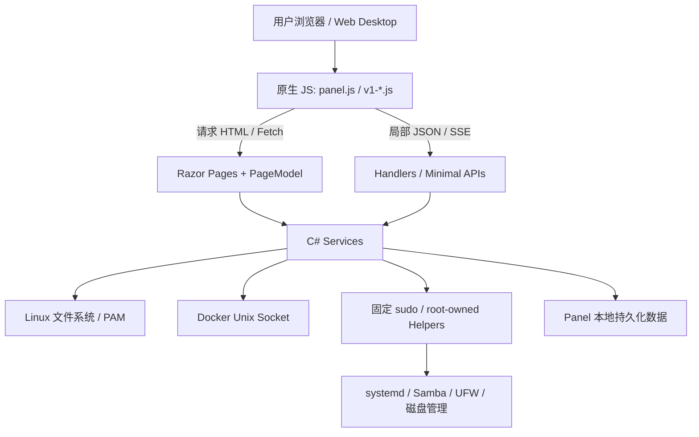
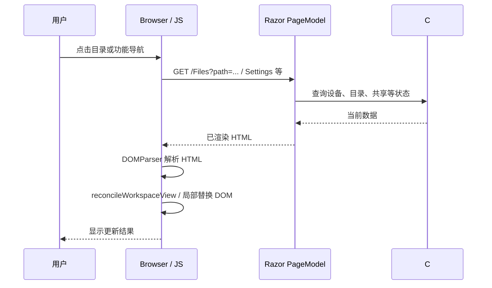
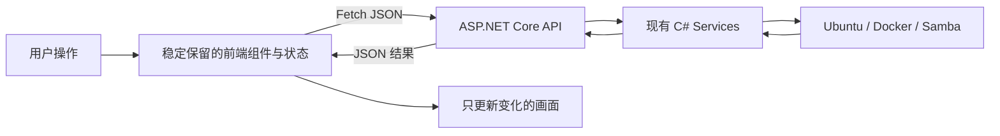

# YRMPanel 项目定位、现状与技术逻辑交接档案

> **文档日期：** 2026-11-22（MYT）  
> **用途：** 项目存档、暂停/恢复开发、技术交接、判断正式版准备度。  
> **源码基准：** [`yuanruoming/yrm-panel`](https://github.com/yuanruoming/yrm-panel) `master` — [`19a106f69ba44e5aa5509331a5036ba952be55b1`](https://github.com/yuanruoming/yrm-panel/commit/19a106f69ba44e5aa5509331a5036ba952be55b1)。  
> **项目源码版本：** `1.0.0-beta.12.2`（`YrmPanel/YrmPanel.csproj`）；这是 BETA12.2，不是正式发布的 `v1.0.0`。  
> **证据边界：** 本档案依据当前 GitHub 源码、部署脚本、测试/验收文档及已确认的产品约定编写；未 SSH 登录实际 Ubuntu 主机，没有完成本轮真实部署或全功能验收。**源码中有功能 ≠ 功能已在实际服务器验证正常。**

---

## 1. 一句话定位

**YRMPanel 是供个人管理其 Ubuntu Server 的轻量 Web Desktop/NAS 管理界面。**

它不是新操作系统，也不是要重新实现 Linux 的文件系统、SMB、Docker、磁盘管理或防火墙。正确职责是：**用符合个人喜好的、快速而稳定的 UI，调用成熟的 Linux / Docker / Samba 服务**。

核心目标：

- **个人单用户管理**：不是面向企业、组织、多人租户或多角色权限系统。
- **桌面式 Web 体验**：壁纸、顶部栏、Taskbar、应用窗口，使用体验应接近 fnOS / DSM，而不是一个传统后台表单网站。
- **功能集中**：Files、SMB、Storage、Docker、Monitor、必要的 Settings；不追求应用商店和无边界扩张。
- **真实系统状态**：从 Ubuntu 和现有服务读取，不建立另一套“假系统状态”。
- **统一数据目录与维护流程**：用户的实际数据仍留在其选定的磁盘/目录中；Panel 的运行数据与用户文件应分开管理。
- **流畅优先**：切换目录和设置不应使整个工作窗口反复消失、闪烁或丢失状态。
- **稳定优先**：不接受修复一个按钮、意外破坏其他页面；不接受重复堆叠兼容层。

### 1.1 不是什么

| 不是 | 原因 |
|---|---|
| Ubuntu 的替代品 | Ubuntu Server、systemd、Linux 用户和内核仍是真正执行者 |
| 一套自研 Docker Engine / Samba Server | Panel 仅管理既有 Docker Socket、Samba 配置与相关服务 |
| CasaOS/1Panel 的直接克隆或通用应用商店 | 产品范围更窄，UI 和操作流程由个人需求决定 |
| 企业多租户后台 | 当前以指定 Linux 用户登录、个人使用为主 |
| 必须用 Vue/React 才成立的项目 | 用户目标是结果和体验；框架只是实现手段 |

## 2. 已确认的产品与 UI 约定

这些属于**已经讨论并确认的要求**，不是可以随意改变的设计建议。

1. **风格**：黑灰色主调、扁平清爽、信息层次自然，避免无意义的 Card 套 Card、过多标题和装饰。
2. **桌面**：壁纸与窗口是视觉核心；保留顶部状态、Taskbar、窗口位置和尺寸。Taskbar 尽量采用统一图标+名称；优先单窗口、少跳转。
3. **文件管理**：真实浏览 Linux 路径。My Files 是逻辑入口/导航集合，不是一套独立复制的文件存储；可访问系统 Root、Home、已挂载卷以及 Quick Access。
4. **SMB**：分享是 Files 文件夹的操作之一，不应另做冗余的独立共享中心。停止分享不删除实际文件。
5. **文件夹图标**：静止，不随展开而旋转或移动。
6. **文件夹交互（最新目标）**：文件夹**单击选中、双击进入**；**箭头单击展开或折叠**。箭头只属于有树状浏览需求的文件夹；不能把这套拦截应用到其他普通链接/按钮。
7. **My Files 顶部入口的特殊情况**：此前已单独确认“单击展开/收起 My Files、双击进入 My Files、一个静态文件夹图标”。它与目录列表行的箭头交互**不是同一规则**；改变这一点需要明确的产品决策。
8. **文件名**：长名称单行省略，不能跑到图标下面；不应因文字被拖选而破坏桌面文件选择体验。
9. **文件操作**：选择、多选、复制、移动、重命名、删除、上传、下载、预览、More/属性菜单尽量遵循原生文件管理器习惯。
10. **导航**：用户不希望每次点击都明显等待、刷新整个内容区或显示新的网页地址；要维持桌面应用的连续感。
11. **功能组织**：日常系统操作归入 Settings；尽量减少独立的 Accounts、Services 等无必要页面。
12. **不得破坏已有正确功能**：修复范围应严格局限，避免通过新函数、重复事件监听器、CSS 覆盖层来掩盖旧问题。

> **重要：** 这些是目标/产品约定。最新代码虽然试图实现其中大部分，但实际 Ubuntu 交互仍有用户报告的严重回退，不能把“代码存在”写成“已验收”。

---

## 3. 当前技术架构（按源码）

| 层次 | 当前技术 | 实际职责 |
|---|---|---|
| 运行平台 | Ubuntu / Debian + systemd | 账户、目录权限、进程与系统服务 |
| Web / API 后端 | ASP.NET Core **.NET 10** | 登录、Razor Pages、文件与系统服务 API、验证、业务逻辑 |
| 页面渲染 | Razor Pages / `.cshtml` | 生成主页面和多数功能页面的 HTML |
| 前端交互 | 原生 JavaScript + CSS | 桌面窗口、Taskbar、动态操作、页面局部替换、对话框、文件树 |
| 部分动态数据 | JSON / Fetch / Server-Sent Events（SSE） | 文件树、系统监控、更新状态等 |
| Docker | Docker Engine Unix Socket | 查询容器、日志及有条件的启停重启 |
| Files | .NET 文件系统 API + Linux 权限 | 浏览、传输、管理真实文件 |
| Samba | 既有 Samba + 固定特权 Helper | 读取/维护 SMB 分享 |
| Storage | `lsblk` 等系统工具 + 固定 Helper | 磁盘/分区发现、挂载与受控操作 |
| 安全/防火墙 | PAM、Cookie Auth、UFW/iptables Helper | 登录与有限的管理员操作 |
| 配置与历史 | 文件系统、JSON、Panel 数据目录 | 设置、凭证密钥、壁纸及历史等 |
| 构建发布 | GitHub Actions + `dotnet publish` | x64/ARM64 自包含 Linux 构建、校验和与 Dev/Stable 发布 |

**目前不是完整 SPA，也没有全面采用 Vue/React。** 现有项目文件没有显示需要数据库来实现这些核心模块。

### 3.1 系统结构



### 3.2 关键源码位置

| 功能 | 当前主要文件 |
|---|---|
| 程序初始化/认证/端口/API | `YrmPanel/Program.cs` |
| 桌面外壳与路由 | `YrmPanel/Pages/Shared/_Layout.cshtml`、`YrmPanel/wwwroot/js/panel.js` |
| Files UI/接口 | `YrmPanel/Pages/Files.cshtml`、`Files.cshtml.cs` |
| 文件系统逻辑 | `YrmPanel/Services/FileManagerService.cs` |
| 文件树的点击/展开 | `YrmPanel/wwwroot/js/v1-tree-navigation.js` |
| 文件选择/其他交互 | `YrmPanel/wwwroot/js/v1-stability.js`、`v1-files.js` |
| Files 的短期设备/SMB 快照 | `YrmPanel/Services/FilesNavigationSnapshot.cs` |
| Docker | `YrmPanel/Pages/Docker.cshtml.cs`、`Services/DockerApiService.cs` |
| Settings | `YrmPanel/Pages/Settings.cshtml(.cs)` |
| Storage / SMB / DDNS / Firewall | `Services/StorageDeviceService.cs`、`SambaManagementService.cs`、`DdnsService.cs`、`FirewallService.cs` |
| 壁纸、头像与配置 | `Services/PanelSettingsStore.cs` |
| 监控 | `Services/MetricsPublisher.cs`、`LinuxSystemMetricsService.cs` |
| 安装/升级/卸载 | `scripts/install.sh`、`scripts/update.sh`、`scripts/uninstall.sh` |
| Linux 服务定义 | `packaging/yrm-panel.service` |

---

## 4. 现在的请求、交互与数据流逻辑

### 4.1 大多数模块：依旧是 HTML 页面驱动



当前 `panel.js` 会保留桌面外壳，并对 Files / Settings 尝试局部协调（`reconcileWorkspaceView`）；Files 又进一步保留路径栏、工具栏、目录容器等，只替换必要子节点。但**请求的基本载体仍是完整 Razor HTML 页面**，且不同操作的事件可能由多个 JS 文件协同处理。

因此：**没有浏览器顶层刷新 ≠ 没有重新请求 HTML ≠ 没有 DOM 更新成本**。

### 4.2 已经存在的异步 JSON / SSE

- `GET /Files?handler=Tree&path=...`：返回目录的子文件夹 JSON，用于展开目录树。
- `GET /Files?handler=Exists`、`GET /Files?handler=Preview`：部分文件检查/预览请求。
- `GET /api/metrics` 与 `GET /api/metrics/stream`：监控快照及 SSE 数据流。
- `GET /api/update/status`：更新进度和可用性。
- `GET /Settings?handler=TaskbarPins`：Taskbar/快捷方式的 JSON 信息。

这证明**不更换前端框架也可以通过 JSON 获取数据**；但当前大多数页面的主导航还没有迁移为只取数据的 API 模式。

### 4.3 正在讨论、尚未实现的目标架构



目标是**去掉“每次用户操作 → Razor 全页面生成 → HTML 解析 → 多处 DOM 重建”这一条不必要的路径**；让普通操作请求结构化数据、使用状态驱动的小范围 UI 更新。

需要区分：

- **已经决定的产品目标**：流畅、稳定、少刷新、保留 UI 和原有服务。
- **合理的技术方向**：为高频交互提供专用 JSON API，减少 HTML 重渲染。
- **未最终确定的手段**：继续使用经过整理的原生 JS、引入 Vue 组件、或其他组件/状态方案；**不能声称 Vue 已采用或已经证实更快**。
- **不会被 JSON 消除的成本**：真实磁盘 I/O、Samba 查询、Docker 操作、网络延迟、首次加载和必要的 DOM 显示。

### 4.4 目前已有的性能尝试

| 项目 | 当前源码行为 | 不足/边界 |
|---|---|---|
| Files 页面预加载 | 鼠标悬停约 100ms 后尝试预取目标页面；短期页面缓存约 4.5 秒 | 预取的仍是 HTML 页面 |
| Files 目录树 | `/Files?handler=Tree` JSON；目录数据缓存约 6 秒 | 只解决树状展开，不代表主目录导航已 API 化 |
| Files 系统状态 | `FilesNavigationSnapshot` 将磁盘与 Samba 只读结果并行加载、缓存约 3 秒 | 缓存到期仍会查询；目录浏览仍有其他工作 |
| Files DOM | 优先保留窗口、侧栏与目录容器，替换局部节点 | 仍有 HTML 解析、事件与状态协调成本 |
| 性能分段 | Files GET 添加 `Server-Timing`（catalog/folders/browse） | 有诊断入口，不等于已测得目标服务器的真实瓶颈 |

---

## 5. 功能现状清单（实现存在 ≠ 实际验证）

状态术语：**已实现代码**＝GitHub 有对应功能/接口；**待实机验收**＝不能保证 Ubuntu 生产环境运行正确；**非当前范围**＝未作为正式版承诺。

| 模块 | 从源码可以确认的实现 | 当前判断 |
|---|---|---|
| 登录与会话 | Linux PAM 指定用户验证、Cookie Auth、会话控制、HTTPS 配置 | 已实现代码；安全/重启回归待实机验证 |
| Desktop | 壁纸、顶部栏、Taskbar、窗口和桌面状态 | 已实现代码；交互完整性存在用户反馈问题 |
| Overview / Monitor | Linux 系统指标、设备信息、SSE 更新 | 已实现代码；监控体验与持续运行待实测 |
| Files 浏览 | Root、Home、My Files、Quick Access、Mounted Volumes、面包屑 | 已实现代码；点击与导航可靠性存在回退记录 |
| Files 文件操作 | 选择、多选、创建、重命名、复制、移动、删除、上传、ZIP 下载 | 已实现代码；大文件/权限/中断场景待实测 |
| Files 预览 | 图片、文本、PDF、视频预览接口，文件范围读取 | 已实现代码；此前发生过预览 URL/路径回退，必须回归 |
| SMB | 显示分享、创建/停止分享、读写模式相关选项 | 已实现代码；需要 Windows SMB 客户端真实验证 |
| Storage | 磁盘/分区发现、挂载/卸载、部分空盘初始化与恢复 | 已实现代码；高风险操作仅能在废弃测试盘上验证 |
| Docker | 容器列表、状态、日志；按配置启停重启 | 已实现代码；**不是**完整 Compose/Stack 管理器 |
| Network | 网络接口与部分详细只读状态 | 已实现代码；不是全面网络控制中心 |
| DDNS | Dynu、Cloudflare/custom 等配置、IP 检测、更新与检查逻辑 | 已实现代码；真实 Provider 场景待实测 |
| Firewall | UFW/iptables 管理、批量规则、危险启用确认机制 | 已实现代码；IPv6/nftables/远程链路有限制 |
| Certificates | 自签名 TLS、手动 PEM 导入和恢复 | 已实现代码；没有自动 ACME/Let's Encrypt 生命周期 |
| Appearance | 壁纸、历史、头像相关 UI/API | 已实现代码；历史缩略图缓存体验仍需实测 |
| Updates | 检查、滚动 Dev 更新、发布物 SHA256 验证、回滚设计 | 有实现；生产更新路径仍需完整验收 |
| Applications | 源码中仍保留应用卡片/快捷方式设计，GET 路由实际重定向 Docker | 兼容/遗留实现；不能当成独立成熟应用商店 |
| Services / Shares 独立页 | 保留路由或入口，但功能已迁移/跳转 | 非独立核心模块 |

**特别说明：** `YrmPanel/appsettings.json` 里的 `Docker:EnableControls` 默认是 `false`；实际安装若有其他配置覆盖，应以运行主机配置为准，不能凭此文件断言所有部署都允许或禁止容器控制。

---

## 6. Files：当前真实逻辑与关键问题

### 6.1 数据来源

- Files 不复制一份 NAS 文件仓库，而是使用 `FileManagerService` 浏览 **Linux 真实文件路径**。
- 浏览默认遵循运行该服务的普通 Linux 用户权限，不把普通文件操作默认当成 root。
- `My Files` 主要发现用户 Home 与已挂载卷下的目录，不是一个脱离文件系统的新数据库。
- Quick Access 是独立于实际目录的快捷入口，不移动文件。
- 默认会跳过隐藏点文件、符号链接与 `lost+found`；显示隐藏项目取决于 UI 参数及相应代码。
- 当前 `Browse()` 枚举最多 3000 项并在排序后返回最多 1000 项：**大型目录并非无限完整列出**，后续需要明确分页/虚拟列表方案。

### 6.2 文件夹点击约定与最新源码

**普通 Files 文件夹行：**

```text
单击文件夹行/文字 → 选中
双击文件夹行/文字 → 进入文件夹
单击箭头         → 立即展开/收起子目录
文件夹图标       → 始终静止
```

**My Files 顶部导航：** 保留此前单击展开、双击进入的特别规则；不要混成普通行行为。

在最新 `v1-tree-navigation.js` 中：

- 使用 `[data-fm-expand]` 响应箭头展开。
- 精确拦截 `a[data-fm-inline-folder]` / `a[data-fm-tree-folder]` 的普通单击默认导航。
- `dblclick` 再触发文件夹链接导航。
- 文件行选择由 `v1-stability.js` 的另一段逻辑处理。

**当前风险：** 这仍涉及多个文件共享事件处理、`preventDefault()` 与合成 `.click()`；此前由于扩大拦截范围发生过“连基础单击都不能用”的严重回退。**最新提交声称修复，但没有获得用户实际 Ubuntu 环境验收，不得标记已解决。**

### 6.3 已出现、需要保留记录的问题

1. 目录点击不流畅、出现等待/加载感。
2. 原本只是改变文件夹展开方式，却波及更广泛的单击和导航。
3. 旧版曾把静态文件夹图标做成移动/旋转，违背 UI 约定。
4. 图片/PDF/TXT/Video 预览曾因当前路径与请求 URL 不一致失效。
5. 长文件名曾换行到图标下方。
6. 安装/诊断产生的孤儿文件仍曾显示在 Files 中，例如文件名前缀为 `ystemctl show yrm-panel.service...` 的对象。当前源码添加了针对性隐藏，但**隐藏 ≠ 删除，且未核验该文件真实身份及实际过滤结果**。
7. 后端普通目录浏览曾重复执行磁盘扫描和 Samba 查询；现已加入短期快照，但真实端到端效果未知。

---

## 7. Settings / Wallpaper / Docker / Storage 的关键逻辑

### 7.1 Settings

当前主要分区从 `Settings.cshtml` 可见：Overview、Storage、Network、Dynamic DNS、Firewall、Certificates、Appearance、About & Updates。部分配置采用 Razor POST 表单、重定向和客户端处理，尚未全部改为无页面替换的 JSON 操作。

### 7.2 壁纸与 Recently Used

- 当前壁纸保存在 Panel 的持久化数据区域；历史壁纸存放在 `wallpaper-history`，保留最多约 10 张，并尝试按内容去重。
- 当前桌面壁纸有版本化 URL `/wallpaper?v=...` 和长期私有浏览器缓存策略。
- Recently Used 历史图片在最近修改后也设置了 `Cache-Control: private, max-age=31536000, immutable`，并改成 `loading="eager" decoding="async"`。
- `PanelSettingsStore` 为壁纸历史哈希添加短期进程内重用逻辑，减少重复对多张原图计算 SHA-256。
- **尚不等于真正生成了独立小尺寸缩略图**；用户曾实际观察到历史壁纸延迟加载，改动后未获得生产环境验收。

### 7.3 Docker

- 通过 Unix Socket `/var/run/docker.sock` 调用 Docker Engine API，不在 Panel 内自建 Docker 容器运行时。
- 列表显示容器及 Compose Project 标签（如存在），支持查询 Logs；控制操作限定 start/stop/restart 且需配置许可。
- 当前不承诺完整 Compose YAML 编辑、Stack 生命周期、应用商店。

### 7.4 Storage / SMB / Firewall

- `StorageDeviceService` / `SambaManagementService` 从系统状态及固定 Helper 获取数据。
- 需要管理权限的操作经过明确的用户/系统确认机制，普通服务进程并非 root。
- 高风险磁盘初始化可能销毁数据；不能把静态测试通过等同于可以在真实数据盘上安全执行。
- Firewall 受 Ubuntu UFW、iptables、Docker 网络模式和 IPv6/nftables 能力边界限制，不能宣传为“完整防护所有 Docker 端口”。

---

## 8. 部署、身份、数据及更新机制

### 8.1 标准 Linux 目录（来自安装脚本）

| 路径 | 作用 |
|---|---|
| `/opt/yrm-panel` | 已发布的服务程序 |
| `/opt/yrm-panel.previous` | 更新时可能保留的上一个程序目录 |
| `/var/lib/yrm-panel` | Panel 数据、更新状态、TLS 与键材料等 |
| `/etc/yrm-panel/panel.env` | 服务运行环境 |
| `/etc/yrm-panel/source.env` | 安装来源、分支、channel、用户与端口等更新参数 |
| `/etc/systemd/system/yrm-panel.service` | systemd 服务定义 |
| `/usr/local/sbin/yrm-panel-update` | 已安装的更新命令 |
| `/usr/local/libexec/yrm-panel-*` | 限定用途的系统管理 Helper |
| `/etc/sudoers.d/yrm-panel` | 指定 Helper 的受控 sudo 授权 |

> 这些是**安装脚本设计的默认路径**，并非本轮在真实主机上检查得到的结果。不要把 `/opt/yrm-panel` 当作用户的 NAS 数据目录，更不要把更新理解为清空用户文件。

### 8.2 身份与权限

- Ubuntu 安装指定现有 Linux 用户，服务以该用户运行；不应该把整个 Web 应用以 root 身份运行。
- Linux 登录走 PAM；会话使用 ASP.NET Core Cookie Authentication。
- systemd 安装时可提供 HTTP 与内置 HTTPS 端口，默认配置逻辑为 HTTP `6080` / HTTPS `6081`；实际安装参数可能不同。
- C# 通过经限制的 root-owned Helper 执行需要管理员权限的具体操作。
- Windows 开发模式与真实 Linux PAM 模式不同，不能用 Windows 浏览器模拟覆盖所有主机权限测试。

### 8.3 Dev 与 Stable 发布

- `.github/workflows/dev-release.yml`：主分支更新后验证源码与测试，并发布 `linux-x64` / `linux-arm64` 自包含包和 SHA-256 到滚动 `dev` Release。
- `.github/workflows/stable-release.yml`：由符合版本号的 `v*.*.*` Tag 触发，要求 Tag 与项目 `<Version>` 一致。
- `scripts/update.sh`：读取 `/etc/yrm-panel/source.env`，按 channel 下载并调用安装脚本，写更新进度；具备安装恢复/上一个版本目录相关逻辑。
- 已确认 Dev Release 存在且在 2026-11-22（MYT）更新过，**不代表 Stable `v1.0.0` 已发布**。

**已有环境的应急命令（只作为文档记录，不要求现在执行）：**

```bash
sudo yrm-panel-update
sudo systemctl status yrm-panel.service --no-pager
sudo journalctl -u yrm-panel.service -n 60 --no-pager
```

更新前需要知道当前主机使用的 channel、是否有未保存配置以及回滚条件；**不应通过重新运行 install.sh 盲目覆盖故障环境**。

---

## 9. 项目目前到底处于什么状态？

### 9.1 已经可以证实

- 当前源码是 `.NET 10`、`1.0.0-beta.12.2`、Razor Pages + 原生 JS；GitHub `master` 最新参考提交是 `19a106f`。
- 核心业务模块及底层服务接口已经写出，不能再视作只有原型画面。
- 有 Linux 发布流程及 Dev Release 资产（x64/ARM64）。
- 有不少 Python 回归测试、Shell 验证、JavaScript 检查与 Linux 文件行为测试脚手架。
- 当前 Files 已有树状 JSON 接口、HTML 导航局部更新及缓存尝试。
- 当前源码中仍有多处彼此耦合的前端事件逻辑。

### 9.2 不能宣称已完成

- 不能证明 Ubuntu 主机上所有 Files 交互已恢复正常。
- 不能证明最新包消除了整个系统的“网页加载感”。
- 不能证明所有模块的文件上传、预览、SMB、Mount、Docker、DDNS、Firewall 都通过了实机端到端验收。
- 不能凭 Python 测试数量证明 .NET 编译与 Ubuntu 服务行为完全无误。
- 不能把“已写缓存 Header”当作壁纸历史视觉体验已经解决。
- **不能把当前 BETA12.2 说成正式版。**

### 9.3 关于版本与测试成本

- 根据用户经历：从 RC 系列迭代到 BETA12.2，约 **43 次 GitHub workflow、至少约 35–40 个测试版本/修复轮次**。这是用户反馈的开发成本数量，不是本次重新审计的 GitHub 统计。
- 最近一次交付前曾报告 **223 项 Python 测试**与浏览器交互验证通过；随后用户仍报告基础点击不能正常使用。这说明**测试覆盖与真实行为之间存在缺口**。
- 当前 `README.md` 标题仍是 **BETA8**，属于明显滞后的旧文档；`V1_ACCEPTANCE.md` 仍声明正式版需要 Windows Build 和 Ubuntu VM 等验收。**今后不能拿 README 版本说明替代源码现状。**

---

## 10. 当前缺陷与发布阻断项（按优先级）

| 优先级 | 项目 | 为什么阻断正式版 | 最低验收要求 |
|---|---|---|---|
| P0 | 基础单击/双击、普通链接、菜单事件回退 | 核心交互可能让系统不可操作 | 全模块点击/键盘/菜单端到端测试，不能只验证 Files |
| P0 | 真实 Ubuntu .NET/服务集成 | 仿真 DOM 不能代表 Linux 权限与系统操作 | Linux Build、真实登录与主要页面功能验收 |
| P0 | 更新与回滚可靠性 | 无法操作时必须能恢复可用版本 | Dev 更新、失败后回滚及静态资产缓存更新验证 |
| P1 | 页面导航流畅度 | 当前核心体验与产品定位不一致 | 测量服务端与浏览器耗时；高频操作避免 HTML 整页工作链 |
| P1 | 文件预览与路径一致性 | 曾出现媒体无法打开 | 图片/PDF/TXT/MP4、范围请求、嵌套目录测试 |
| P1 | 安装残留与文件名排版 | 文件管理器显示与过滤不可靠 | 明确完整路径、精确过滤，不隐藏用户自己的脚本 |
| P1 | Recently Used 图片重载 | 影响桌面观感、重复 I/O | 不变图片复用缓存；必要时生成固定尺寸缩略图 |
| P1 | 高风险操作安全 | Storage/Firewall/SMB 错误会损害实际环境 | 独立废弃测试环境验收权限、失败路径、恢复机制 |
| P2 | 旧页面/脚本与过期文档 | 增加维护混乱 | 明确归属、删除真正废弃逻辑、同步 README/验收清单 |

**正式版标准应当是上述关键行为得到验证，而不是某个前端框架被替换。**

---

## 11. 后续技术路线：已定目标 vs 未定方案

### 确定不变的原则

1. 保留现在已经确认的视觉设计，不因为架构改变重画 UI。
2. 保留成熟的 Linux 服务与大部分 C# Service；不要在 Panel 内重写 SMB / Docker / 磁盘引擎。
3. 追求低延迟、局部更新、稳定状态；不是用 Fade/Spinner 掩盖刷新。
4. 控制事件所有权：同一个 UI 操作应有一个明确的处理入口。
5. 避免补丁堆叠：如组件内部结构已混乱，重写该组件的完整实现并移除旧监听，而非继续追加新覆盖函数。
6. 真实环境验收不能由用户承受几十轮重复部署来替代自动验证。

### 尚未达成工程验收的方案

**API-first 的高频交互改造：** 页面初次进入仍可由 Razor 生成，但进入目录、刷新列表、状态变化可经专用 JSON 接口完成。一个稳定的前端状态层接收 JSON 并更新对应节点。该方案与是否使用 Vue 是两个独立决策。

**Vue / SPA：** 曾提出作为统一组件/状态管理方向，但**截至本档案日期，未正式移植、未做完整实机性能对比，也未获证实必须采用**。不能将其写成已经确定的迁移计划。

**必须先解决的工程问题：** 完整 C# Build、实际浏览器回归、Linux 集成、服务端 `Server-Timing` 与浏览器网络/Performance 指标、可回滚发布。

---

## 12. 代码修改与交付的硬性约定

1. **版本保持 BETA12.2**，除非明确决定正式升版；不要每次 Bug 修复擅自产生一个 BETA 编号。
2. 以 GitHub `master` **最新 Commit** 为基准；不要覆盖用户已推送的最新改动。
3. 修改前先判断功能归属和事件所有权；不做无关的顺带重构。
4. **禁止补丁式堆叠**：不通过第二个 Listener、第二套 CSS 规则、额外 Patcher 掩盖原问题。
5. 修改 C#/Razor/JS 时，同步维护受影响的 Python 与浏览器测试；测试必须覆盖正向操作及**其他模块不受影响**。
6. 交付前尽可能完成 .NET Build、相关测试、真实浏览器端到端验证；未完成什么就如实写明。
7. 交付只包含**实际修改或必需新增文件**的 ZIP；每个文件提供完整内容，保留项目相对目录，可直接覆盖。
8. 不使用 CMD、PowerShell/Python Patch 工具让用户自行合并；不要在替换包内塞无关 README/TXT/MD。
9. 附英文 Commit Message；未经明确授权，不推送 GitHub。
10. 优先讲清楚事实、限制和损坏风险，不要声称“最后一个 Bug”“已经正式完成”或用测试数量代替质量证明。
11. 若以后交付**文档**而不是代码替换包，可单独提供 `.md`；这不改变上述代码替换 ZIP 规则。

---

## 13. 恢复开发或交接给另一位开发者时，首先应该知道的事

> 这段不是要求用户现在继续测试，而是给未来接手者的技术入口。

- **先读最新源码，不要先相信旧 README 或先前助手的完成宣告。**
- **先确认当前版本能否登录、能否点击普通链接、能否使用 Files/Settings。** 这些是发布阻断项。
- **现有实际项目并非 Vue，仍是 Razor + 原生 JS。** 不要直接引入第二套框架并让两套事件系统同时接管 DOM。
- **不要破坏数据目录**：安装产物 `/opt/yrm-panel`、Panel 配置 `/var/lib/yrm-panel`、Linux 用户真实文件是不同层次。
- **保留并检查 sudo Helper 的权限边界**，不要用“全局 root”绕过权限问题。
- **减少用户手工测试**：应在可重复的隔离环境中证明基础操作和回归行为后，才提交实际使用验收。
- **正式版不以新功能数量衡量**：基础操作、数据安全、流畅性、可恢复性与稳定性优先。

## 14. 文档结论

**YRMPanel 已经不是“还差一点界面”的原型，它具备真实后端与大量模块；但也不是已经完成验收的正式软件。** 当前最严重的风险不是缺少功能，而是高频导航架构与前端事件逻辑不统一、部分修复造成回退，以及缺少足以证明交付可靠的实际集成验收。

它应继续被定义为：

> **建立在 Ubuntu Server 既有成熟服务之上的、个人使用的轻量 NAS/Web Desktop 管理界面。以稳定、流畅、低维护成本为第一优先级。**

是否继续开发、何时恢复开发，都不改变这个定位。已有成果应被完整保留；在没有更高可靠性证据之前，不应再次以未验证的版本要求用户承担反复部署与排查成本。

---

## 15. 本档案的依据与复核边界

**当前源码与配置：**

- [`YrmPanel.csproj`](https://github.com/yuanruoming/yrm-panel/blob/19a106f69ba44e5aa5509331a5036ba952be55b1/YrmPanel/YrmPanel.csproj)
- [`Program.cs`](https://github.com/yuanruoming/yrm-panel/blob/19a106f69ba44e5aa5509331a5036ba952be55b1/YrmPanel/Program.cs)
- [`Pages/Files.cshtml.cs`](https://github.com/yuanruoming/yrm-panel/blob/19a106f69ba44e5aa5509331a5036ba952be55b1/YrmPanel/Pages/Files.cshtml.cs)
- [`wwwroot/js/panel.js`](https://github.com/yuanruoming/yrm-panel/blob/19a106f69ba44e5aa5509331a5036ba952be55b1/YrmPanel/wwwroot/js/panel.js)
- [`wwwroot/js/v1-tree-navigation.js`](https://github.com/yuanruoming/yrm-panel/blob/19a106f69ba44e5aa5509331a5036ba952be55b1/YrmPanel/wwwroot/js/v1-tree-navigation.js)
- [`Services/FilesNavigationSnapshot.cs`](https://github.com/yuanruoming/yrm-panel/blob/19a106f69ba44e5aa5509331a5036ba952be55b1/YrmPanel/Services/FilesNavigationSnapshot.cs)
- [`Services/PanelSettingsStore.cs`](https://github.com/yuanruoming/yrm-panel/blob/19a106f69ba44e5aa5509331a5036ba952be55b1/YrmPanel/Services/PanelSettingsStore.cs)
- [`scripts/install.sh`](https://github.com/yuanruoming/yrm-panel/blob/19a106f69ba44e5aa5509331a5036ba952be55b1/scripts/install.sh)
- [`scripts/update.sh`](https://github.com/yuanruoming/yrm-panel/blob/19a106f69ba44e5aa5509331a5036ba952be55b1/scripts/update.sh)
- [Dev Workflow](https://github.com/yuanruoming/yrm-panel/blob/19a106f69ba44e5aa5509331a5036ba952be55b1/.github/workflows/dev-release.yml)
- [Stable Workflow](https://github.com/yuanruoming/yrm-panel/blob/19a106f69ba44e5aa5509331a5036ba952be55b1/.github/workflows/stable-release.yml)
- [`V1_ACCEPTANCE.md`](https://github.com/yuanruoming/yrm-panel/blob/19a106f69ba44e5aa5509331a5036ba952be55b1/V1_ACCEPTANCE.md)（旧验收说明仍可作为检查范围参考，版本文字可能过期）

**用户已经确认的长期产品约定**：来源于本项目 RC → BETA12.2 的反复讨论，属于需求与约束；非代码证明。  
**未执行的检查**：本轮没有直连 Ubuntu SSH、没有新部署、没有实测当前目标服务器的延迟、没有重新执行全部 .NET/浏览器集成测试。因此本文不提供“已正式验收通过”的结论。
